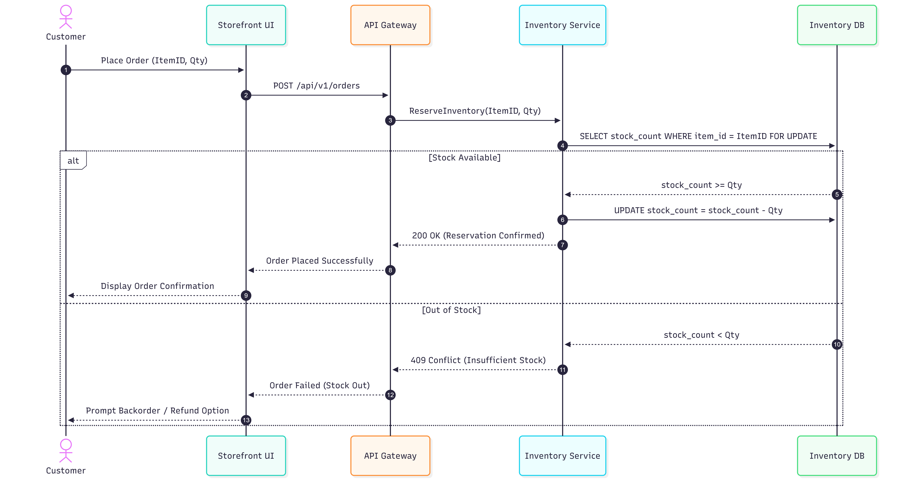

# 💼 End-to-End Business Analysis & Systems Architecture Portfolio

## 📌 Executive Summary

This repository documents the complete 5-phase lifecycle delivery of an **Enterprise Real-Time Inventory & Order Synchronization Microservice**. It translates business problems into technical architecture, functional specifications, analytical SQL queries, and project governance frameworks.

---

## 📁 Repository Structure & Artifact Index

| Phase | Directory | Key Artifacts | Focus & Deliverables |
| :--- | :--- | :--- | :--- |
| **Phase 1** | [`phase-1-initiation/`](./phase-1-initiation/) | `BRD.md` | Business case, 5 Whys root cause analysis, RACI matrix |
| **Phase 2** | [`phase-2-architecture/`](./phase-2-architecture/) | `inventory_sequence_diagram.png` | AS-IS vs. TO-BE process flows, UML sequence diagrams |
| **Phase 3** | [`phase-3-requirements/`](./phase-3-requirements/) | `SRS.md`, `RTM.csv` | IEEE 830 SRS, Gherkin BDD user stories, Traceability Matrix |
| **Phase 4** | [`phase-4-analytics/`](./phase-4-analytics/) | `schema.sql`, `queries.sql`, `dashboard_spec.md` | OLTP/OLAP DDL schemas, CTE/Window function SQL, Power BI DAX specs |
| **Phase 5** | [`phase-5-governance/`](./phase-5-governance/) | `WBS.md`, `UAT_Test_Suite.csv`, `Change_Request_Template.md` | Work Breakdown Structure, UAT test execution matrix, Change Control |

---

## 🛠️ Project Phase Breakdown

### Phase 1: Initiation & Business Requirements (BRD)
* Identified core business drivers: **14.2% order cancellation rate** and **$180,000 lost revenue** due to inventory overselling.
* Defined project scope, stakeholder alignment, and RACI governance matrix.

### Phase 2: Systems Architecture & Sequence Flows
* Designed real-time event-driven transaction flows between Storefront UI, API Gateway, Inventory Microservice, and Database.

### Phase 3: Requirements Engineering & Agile Backlog
* Formatted IEEE 830 compliant **Software Requirements Specifications (SRS)** covering Functional (FR) and Non-Functional Requirements (NFR).
* Modeled Behavior-Driven Development (BDD) scenarios using **Gherkin syntax** (*Given / When / Then*).
* Maintained 100% requirements-to-test coverage via the **Requirements Traceability Matrix (RTM)**.

### Phase 4: Data Analytics & Executive BI Reporting
* Designed **OLTP 3NF** transactional database tables and **OLAP Star Schema** analytical data warehouses in PostgreSQL.
* Authored complex analytical queries utilizing **Common Table Expressions (CTEs)** and **Window Functions** (`LAG()`, `OVER()`) to track stock velocity and lost revenue.
* Defined Executive Power BI dashboard specs and dynamic **DAX measures**.

### Phase 5: Agile Project Governance & Quality Assurance
* Structured a 5-level **Work Breakdown Structure (WBS)** for scope management.
* Executed **User Acceptance Testing (UAT)** scripts to validate business pass/fail criteria.
* Managed scope change requests using a standardized **Change Control Request (CR)** impact analysis framework.

---

## 🧰 Tools & Technologies
* **Diagramming & Modeling:** Mermaid.ai, PlantUML, BPMN 2.0
* **Requirements & Governance:** IEEE 830, ISO 29148, Gherkin BDD, RTM, WBS
* **Data Engineering & Analytics:** PostgreSQL, SQL (CTEs, Window Functions), Power BI, DAX
* **Version Control:** Git, GitHub
